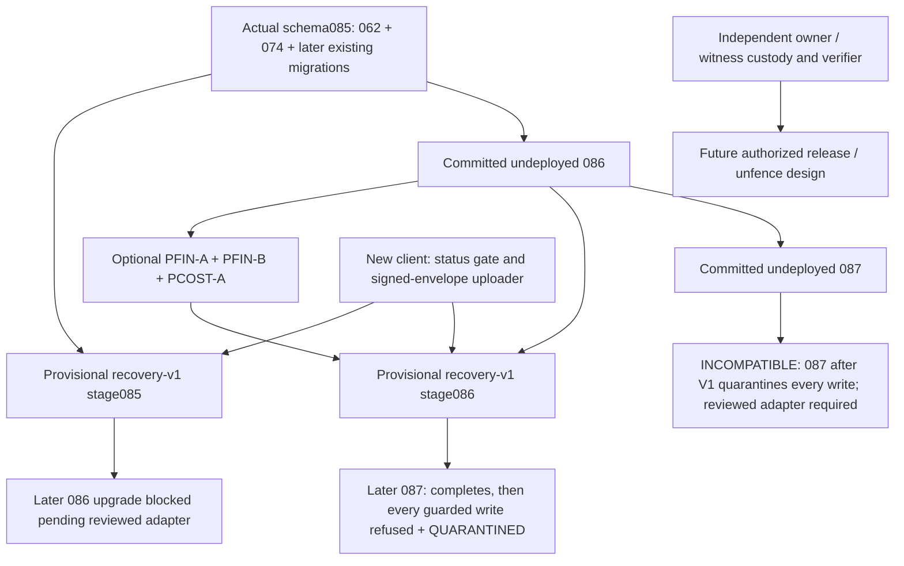

# Provisional recovery database boundary

`supabase/migrations-provisional/RECOVERY_V1_guards.sql` is unnumbered, local implementation SQL. No application, deployment or migration runner installs it automatically. It is not Recovery Migration 088. Production remains **NO-GO**.

The installer accepts only the actual `idem_begin` source digests and primary keys verified in the repository:

| Stage | Helper source | Source MD5 | Ledger identity / advisory lock |
|---|---|---|---|
| 085 | historical 074 | `afca065fea226a0c7a5b9bb56b540a9d` | UUID key / `hashtext('idem:' || key)` |
| 086, committed but undeployed | historical 086 | `c9f577ed5608de19b25c00c649deaf50` | organization + UUID / `hashtext('idem:' || org || ':' || key)` |

No numbered migration or pinned financial function is changed. An existing unknown contract, unknown required table, pre-existing recovery-v1 schema/role, or installed 087 is refused at install time. **087 applied AFTER V1 is not blocked by the DDL event trigger**: 087 disables every event trigger before it runs (087_recovery_hold.sql:63-75). Instead, every guarded row write, every ledger write and every status read re-checks the installation (`recovery_v1.integrity_problem`). Once 087's schema exists, the event trigger is not enabled, or the install record is missing, every guarded write is refused (`integrity:...`) and status reports QUARANTINED. The stage-86 harness proves this with the real 087 inside a rolled-back transaction: 087 completes, then a guarded write is refused and status is QUARANTINED. A later attempt to replace the helper, change its primary key or disable a registered public trigger is blocked by the provisional DDL backstop; 087 is handled differently (next sentences). This backstop is a protection against supported DDL mistakes; a PostgreSQL superuser/host attacker can disable or remove its enforcement.

## Same-key fencing

`dr-fence-keys.sql` calls the operator-only `recovery_v1.fence_key` interface. The `orvix_recovery_operator` role is `NOLOGIN`; installation assigns it to nobody. The SQL requires explicit database name and physical system identifier, a valid tenant/shop/actor/RPC/key, a preserved evidence SHA-256, an incident identifier and an authorization reference. Expected target values must come from a separately reviewed, preserved target record. Reading the expected value from the same connection proves nothing about operator targeting.

The helper takes exactly the installed `idem_begin` transaction advisory lock. A committed/resend winner remains unchanged. A fence winner stores an immutable registry entry and a schema-compatible sentinel in the same transaction. The actual 085 helper rejects a sentinel's deliberately mismatching request hash; 086 additionally records the sentinel as `abandoned`. No pre-existing ledger row, including a completed response, is overwritten. The response never asserts that absent rows prove the original operation did not happen.

Ledger deletion is skipped while v1 is installed, including the original 30-day prune. `recovery_v1.ledger_retention_report()` (operator role only, read-only, deletes nothing) reports the numbers needed to size storage, per organization and in total:

- ledger rows, rows kept beyond the original 30-day window, the oldest row, and row bytes;
- fenced keys;
- evidence records and bytes, and checkpoint receipts;
- total ledger and evidence relation sizes.

Retention requirements are in "Installation and reopen options". Fences and original operation records therefore survive routine pruning; retention sizing and monitoring are deployment prerequisites. Updates cannot change operation identity; an existing non-NULL completed response cannot be overwritten. This intentionally disables response-purge mutations until an evidence-aware retention design is approved.

Dependencies can be supplied as UUIDs to `fence_key`; unresolved dependencies are counted in the audit and response. The interface never executes, regenerates keys, reconstructs an operation, or automatically fences a dependency. Inspect the preserved offline queue/id map and the complete dependency graph before any separate decision. A different-key re-entry is outside the fence guarantee. Refunds, voids, supplier payments, stock movements, shift closure and receipt identities remain unresolved until separately reconciled.

`dr-unfence-key.sql` exercises `request_unfence`. V1 **always denies removal**, audits the request, and leaves the fence intact. It defines the authorization interface without treating operator names, JSON assertions, a service key, a backup, or manual reconstruction as independent owner authorization. No independent owner enrollment/verifier is provisioned.

## Per-organization restricted recovery

**Installation is an outage by design (correction pass P5, hardened in review rounds 2 and 4).** Run it only as `psql -X -v recovery_v1_install_ack=restrict-every-organization -f RECOVERY_V1_guards.sql` against an isolated database.

- The file opens its own transaction with `BEGIN` as the very first statement.
- It passes the per-invocation psql variable as the installer function's argument; a stored session, role or database setting or `PGOPTIONS` value is never consulted. Always run with `-X`: a `.psqlrc` that sets the variable would be a deliberate acknowledgement.
- It then creates EVERYTHING inside one call of a session-temporary function, after the acknowledgement check.

Each harness run proves that nothing is created in four cases:

1. plain `psql -f` with default settings;
2. a session-level `SET`;
3. a database-level setting;
4. a client that ignores psql meta-commands and runs every statement on its own connection, even with the acknowledgement set at database level. The session-temporary installer does not exist on the other connections.

The acknowledgement is recorded in `recovery_v1.install`. The install is written to the append-only audit with the number of organizations restricted. Installing on a live database restricts every organization immediately, and V1 has no reopen path (see "Installation and reopen options" below).

All existing organizations install as `RESTRICTED`. Missing state also denies writes. `RESTRICTED`, `RECONCILING` and `QUARANTINED` block the same protected writes. There is no production transition to `ACTIVE`. The local SQL smoke uses a clearly marked direct superuser fixture update to test ACTIVE behavior; that test setup is not an authorization path.

`ENABLE ALWAYS` row triggers cover the existing financial/ownership tables, their child rows, and any already-installed PCOST cost side tables. Both OLD and NEW rows are checked (correction pass P4, extended in review round 2), resolving:

- the row's own organization column;
- every financial parent: the shift of a sale; the sale of a refund/void request, sale item or cost row; the purchase order of a supplier payment or PO item; product, product unit, price level, supplier; transfer source and destination shops; the product of a cost row;
- **every column named `*_by`, plus `cashier_id`, `actor_id` and `user_id`**, taken from the row itself, so a new `*_by` column is covered automatically;
- the polymorphic `reference_id` of a stock movement and `entity_id` of an audit row. These resolve to a sale, shift, purchase order, refund/void request, transfer or supplier payment; an audit `entity_id` can also resolve to a product, product unit, user, shop, supplier, category, brand, unit type, price level or organization;
- the products and sale items named inside a refund request's `items` JSON.

A product, product unit or sale line also resolves the organization of any PCOST-A cost row that already names its id (review round 4). So within one transaction, a cost row written first for an id that does not exist yet cannot later be attached to a parent created in another organization. `cross-org-cost-smoke.sql` refuses this even with both organizations ACTIVE. Two concurrent transactions are not covered (see Known limits). Most of these columns have no foreign key, so each is resolved explicitly. A row must resolve to exactly one organization: a row that links two organizations is refused even when both are ACTIVE, and a row that touches a restricted organization through any of these is refused. A non-NULL strict parent reference (shop, shift, sale, purchase order, supplier, product, product unit, transfer) that resolves to nothing is refused as `dangling_reference`, and so is changing a row's `id`. PCOST-A writes cost side rows from BEFORE triggers before their parent exists (deferred foreign keys). So on `product_costs`, `product_unit_costs` and `sale_item_costs` the product and unit ids are not dangling-checked, and `sale_item_id` never is. Their own `org_id`, and `sale_id`, still are. `financial-smoke.sql` proves that creating a product with a cost, and a unit with a purchase price, still works in an ACTIVE organization. `cross-org-smoke.sql` and `cross-org-cost-smoke.sql` test all of this with direct service_role and superuser writes.

Known limits that remain:

- **Delete-and-reinsert across two ACTIVE organizations.** A privileged writer in two ACTIVE organizations can delete a parent row and re-insert the same id in the other organization. Rows that referenced it are not re-checked in reverse. A RESTRICTED organization cannot be reached this way, because it cannot write.
- **Some ids are only checked for organization mismatch, not for dangling.** These are acting-user columns and polymorphic ids (`entity_id`, `reference_id`). An id that does not exist yet passes, and a later insert under that id in another ACTIVE organization could re-link it. An audit `entity_id` of an entity type not listed above is not resolved. `idempotency_keys.actor_id` is not checked; it is writable only through definer functions or by a superuser.
- **Cost rows under concurrency.** Two concurrent transactions in different ACTIVE organizations, one creating a product with a known id and one inserting a cost row for that same id (`ON CONFLICT DO NOTHING`), can both commit. The cost row's organization then differs from the product's, and later updates of that product are refused. The attacker must know the other organization's id in advance, and product ids are random UUIDs. A deferred constraint trigger comparing the two organizations at commit would close this.
- **Stale unit-cost product ids.** `product_unit_costs.product_id` is neither foreign-keyed nor dangling-checked, and the reverse lookup does not cover it. After a unit moves to another product and the old product is deleted, a product re-created under that id in another organization is linked to the stale cost row. The app never reads that column, so nothing leaks; the unit's price update is refused from then on.
- **Integrity check scope.** It detects 087, a disabled or missing event trigger and a missing install record. It does not detect a superuser dropping an individual row trigger while the event trigger is briefly disabled. Superusers are outside the boundary.
- **Per-row cost.** Measured by the database review on 20,000-row bulk writes:

  | Operation | Unguarded | Guarded |
  |---|---|---|
  | Insert | 61 ms | 5.2 s |
  | Update | 115 ms | 8.8 s |

  That is about 0.25–0.45 ms per row. Every write takes `FOR SHARE` on its organization's state row, which creates MultiXacts under concurrency; no deadlock cycle was found.
- **Audit growth.** `recovery_v1_transition` records at most 60 attempts per user per hour (indexed), so one user cannot block another, such as a cashier blocking the ADMIN. Further calls are refused without writing. Every recorded input is capped at 500 characters (state 40) on both the denied and the applied path. The count is not locked: concurrent calls can overshoot (an independent probe measured 79 recorded attempts after 20 parallel calls starting at 59).
- **Table owners can bypass the guard.** An owner can build an inheriting child table or swap a view or name. On Supabase, `postgres` is a non-superuser owner. Owners, like superusers, are outside the supported boundary.
- **New organizations cannot be created** while V1 is installed, because they have no recovery state. Onboarding is closed.
- **Error masking and platform rows.** The guard is a BEFORE trigger, so an RLS refusal of a guarded write surfaces as retryable `PT503 ORG_SUSPENDED`, not as an RLS error. Platform audit rows with no shop and no actor resolve to no organization and are refused.

A denial uses SQLSTATE `PT503` and `ORG_SUSPENDED`, preserving retryable/unavailable behavior for clients instead of declaring an uncertain financial operation permanently rejected. Each denial emits a metadata-only `RAISE LOG` record. PostgreSQL rolls back table audit inserts with an aborted statement; durable audit of rejected writes therefore requires preserved server logs and independently protected log shipping. A compromised host can suppress those logs. Transition attempts/denials use returned JSON and an append-only audit table; the caller must commit its transaction. Invalid SQL argument types rejected before function entry require request/server logging.

Supabase authentication session/metadata maintenance in `auth.*` is not broadly disabled: affected users must still be able to authenticate for read-only work and upload surviving evidence. Authentication identity/owner trust remains an unresolved external authority issue; changing auth identities cannot turn a restricted organization ACTIVE through this implementation. PostgreSQL owners, superusers, host administrators and restore tooling capable of removing triggers remain outside the supported authorization-boundary guarantee.

Reads keep existing tenant/cost policies. `recovery_v1_status` returns recovered-as-of (NULL until established), uncertainty strings and required-evidence state. Existing tables and financial reports remain historical/uncertain reads; their amounts, stock, profits, settlements and shift states are not proof of complete recovered history. Legacy clients cannot render v1 uncertainty indicators and require upgrade/isolation. No successful restore automatically releases restrictions, edits original timestamps, or authorizes replay/re-entry/stock correction.

## Installation and reopen options (correction pass P5 analysis)

| Option | Effect | Verdict |
|---|---|---|
| A. Current: install restricts every organization; no ACTIVE path except a superuser `UPDATE` | Fail-closed; full outage on a live database | Kept, now behind an explicit acknowledgement so it cannot happen by accident |
| B. Install with an "adopt ACTIVE" mode for organizations without an incident | No outage | **Rejected.** After a disaster restore, re-installing in this mode is an infrastructure-only reopen, and nothing in V1 can tell a fresh adoption from a post-incident reinstall. |
| C. Per-organization install list (listed organizations ACTIVE, others RESTRICTED) | Partial outage | Rejected for the same reason as B; the list is an infrastructure assertion. |
| D. Owner-signed release statement verified in the database (ES256 in PL/pgSQL, as Orvix Control migration 205 already does for passkeys), against an owner key pinned outside the recovering host | Real reopen path | **Prerequisite, not implemented.** It needs the owner key enrolled and pinned independently (in client builds or a separate witness), otherwise the infrastructure that installs the key could install its own. |

Until D exists, V1 SQL must not be installed on a database that serves live trading. It is a containment tool for an already-declared incident on an isolated copy.

Ledger retention requirements before any production use:

1. Pruning stays disabled for any organization that is not ACTIVE, and for every fenced key, permanently.
2. For ACTIVE organizations, a future policy may delete only rows that are older than the client's maximum key-execution window (`KEY_EXPIRED`), not fenced, and not named by any preserved incident record. Each deletion batch is recorded in the append-only audit with counts and the digest of the deleted keys.
3. Storage must be sized from `ledger_retention_report()`: the current ledger row bytes, multiplied by expected days without pruning, plus evidence bytes, plus 50 % headroom. Alert at 70 % of the volume.
4. Response purging (086 `op_purge_responses`) stays disabled while V1 is installed. A completed response is evidence for an unknown outcome.

None of this is implemented beyond the read-only report. No row is deleted by V1.

## Client and evidence interfaces

Only active app users may call the public interfaces; all calls bind to their organization, and non-admin storage is limited to their assigned shop.

- `public.recovery_v1_status(p_org_id text)` returns `{protocol:'orvix-recovery-v1',org_id,state,recovered_as_of,uncertainties,required_evidence:true}` for the caller's organization only.
- `public.recovery_v1_transition(org,state,reason,evidence_reference)` lets an organization ADMIN apply contained states; ACTIVE and invalid/unauthorized requests return an audited denial.
- `public.recovery_v1_store_evidence(p_envelope jsonb)` stores original device envelopes keyed by organization/hash and organization/device/key/sequence. The organization and shop must match the authenticated caller; a non-admin must be the original actor, while an ADMIN can preserve another same-org historical actor's opaque evidence. Multiple observations of the same stable operation ID are allowed at different sequence numbers.
- `public.recovery_v1_store_checkpoint(p_receipt jsonb)` stores original witness receipts keyed by organization/hash and organization/witness/stream/sequence.

Storage is append-only, exact retries are idempotent, and conflicts never rewrite originals. Both storage interfaces return `verified:false`. The database neither verifies P-256 signatures nor enrolls device/witness public keys, proves the latest checkpoint, infers completeness, or grants owner authority. Independently pinned verification happens in the client/verifier interfaces. Client/API roles cannot SELECT these opaque confidential records or their sensitive financial payloads directly. There is a 256-KiB per-record and 50-MiB per-organization per-storage-class limit; refusal preserves local originals and never deletes old evidence.

## Dependency graph



PFIN report indexes/functions can exist independently before v1; PCOST must be installed first so its additional tables receive guards. Creating a new cost table after v1 without its guard is refused. Held PFIN-C was inspected read-only and never applied or changed. Its refund cap does not establish recovery completeness. Existing 087 is not weakened: its held `recovery.guard_tg` blocks sentinel insertion and its public `recovery_%` registry requires coordinated ownership/snapshot work. An additive schema by itself cannot safely bypass those constraints. No 087 adapter/release or 088 reconstruction is claimed.

## Reproduce safely

```sh
# each run also proves: install refused without acknowledgement; cross-org writes refused; retention report read-only
python3 tools/recovery-v1/db/db-smoke.py --stage 85
python3 tools/recovery-v1/db/db-smoke.py --stage 86
python3 tools/recovery-v1/db/db-smoke.py --stage 86 --financial
```

The harness accepts no database URL/host/credentials. Every invocation initializes its own new 0700 `/private/tmp/orvix-recovery-v1-db-*` cluster, disables TCP, uses its private 0700 Unix socket, restores only schema code, seeds synthetic records, and stops only that marked cluster. No Docker/existing services are used or changed. Logs, synthetic dumps, encrypted simulated-recipient output and `result.json` are preserved. The harness never reads `.pgpass` or ambient `PG*` connection settings.

The test source used on 2026-10-21 was the existing schema-only snapshot `/Users/waiyan/shwephala-migration/20261011T2347Z/schema.scrubbed.sql`, SHA-256 `ed1fadc304ecc51b2ef3024423cb3388eba0c58f7d286f50c41077baa7975270`. This historical scrubbed pre-go-live schema is not a business-data backup or a post-2026-10-11 recovery point. A byte-identical schema-only copy is included as `fixtures/schema-061.scrubbed.sql` and is the default test source; `--schema` can supply an explicit replacement. Before copying, screening found no data sections/COPY-from-stdin, private-key blocks, quoted JWT tokens or live API-key literals. No data snapshot was read. The harness loads actual numbered 062..085/086 unchanged. Plain PostgreSQL 16 uses explicit auth/storage/publication platform shims, omits unavailable pg_cron/pg_net/vault extension creation, and removes only PG17 MAINTAIN grants from its temporary schema copy. These limitations prevent a full deployed-Supabase claim.

**Normal-operation regression (review round 3).** `db-smoke.py --stage 86 --financial --phase-d-regression guarded|unguarded` runs the existing phase-d business suites t05–t19, guarded with every organization ACTIVE versus without V1. Organizations the suites create mid-run get pre-seeded ACTIVE states (synthetic fixture). Results:

| Run | Passed | Failed |
|---|---|---|
| Unguarded | 445 | 5 |
| Guarded | 428 | 18 |

The 5 unguarded failures also fail guarded and are a pre-existing harness-ordering artifact. The 13 guarded-only failures are all still refusals:

- 6 cross-organization `org_id` changes and inserts now fail with `ORG_SUSPENDED` instead of the RLS error;
- 7 `app_config` writes are refused by design, which also aborts t16.

No check that passes unguarded is allowed through when guarded. The guarded run records 446 checks against 450, because t16 aborts on the `app_config` refusal before its last checks. t13 aborts in both runs: it dials a default socket the harness does not provide. Evidence: `docs/recovery-v1/evidence/correction-pass/phase-d-regression/`.

Final verified configurations after the correction pass and review rounds 2–4 (supersede the earlier 73-, 75- and 81-assertion runs):

| Configuration | Original financial tests | All SQL assertions | Concurrent resend/fence | Encrypted restore | Install refused without ack (4 cases) | Real 087 after V1 |
|---|---|---|---|---|---|---|
| Actual 085 | 29 pass, 0 fail | 102 pass, 0 fail | completed row preserved | exact synthetic row verified | yes | n/a |
| Actual 086 | 29 pass, 0 fail | 102 pass, 0 fail | completed row preserved | exact synthetic row verified | yes | incompatible (writes refused, QUARANTINED) |
| Actual 086 + PFIN-A/B + PCOST-A + PSAFE-A | 29 pass, 0 fail | 115 pass, 0 fail | completed row preserved | exact synthetic row verified | yes | incompatible |

Final evidence: `docs/recovery-v1/evidence/correction-pass/` (result.json and the cross-org, cost, retention, install-refusal (including per-connection) and 087 logs of each run, plus the phase-d regression results). The clusters were stopped after each run. The earlier `docs/recovery-v1/evidence/db/` directory and its `summary.json` record the pre-correction runs and are kept as history.

Initial harness runs are retained: sandbox shared-memory rejection `183_0k7s`; output parsing warning `krud0j98`; provisional CASE syntax failure `q_ap46fi`; one drift-test parameter-name failure `u6m2fbzn`. Those errors were corrected without changing numbered SQL or weakening assertions. The first optional financial-stack attempt `rc3sj5yo` exposed a pre-existing PSAFE-A preflight constant-regprocedure lookup failure before 087 exists. The authorized narrow fix replaces two planning-time `::regprocedure` constants with nullable `to_regprocedure` calls in that unnumbered provisional file. The final financial-stack run installs PSAFE-A before 087 and verifies its denial of ownership drift in a rolled-back minimal 087-shaped fixture. That probe is not a full 087 integration test.

Script 2 should exhaustively attack multi-session state/fence races, stale snapshots and rollback/restore loss, side-table tenancy, function/trigger/DDL privilege changes, pruning/purge horizons, duplicate keys across organizations, evidence quota/identity conflicts, denial-log preservation, malicious old clients, and unsupported 087 integration. This Script 1 smoke is not that adversarial phase.
